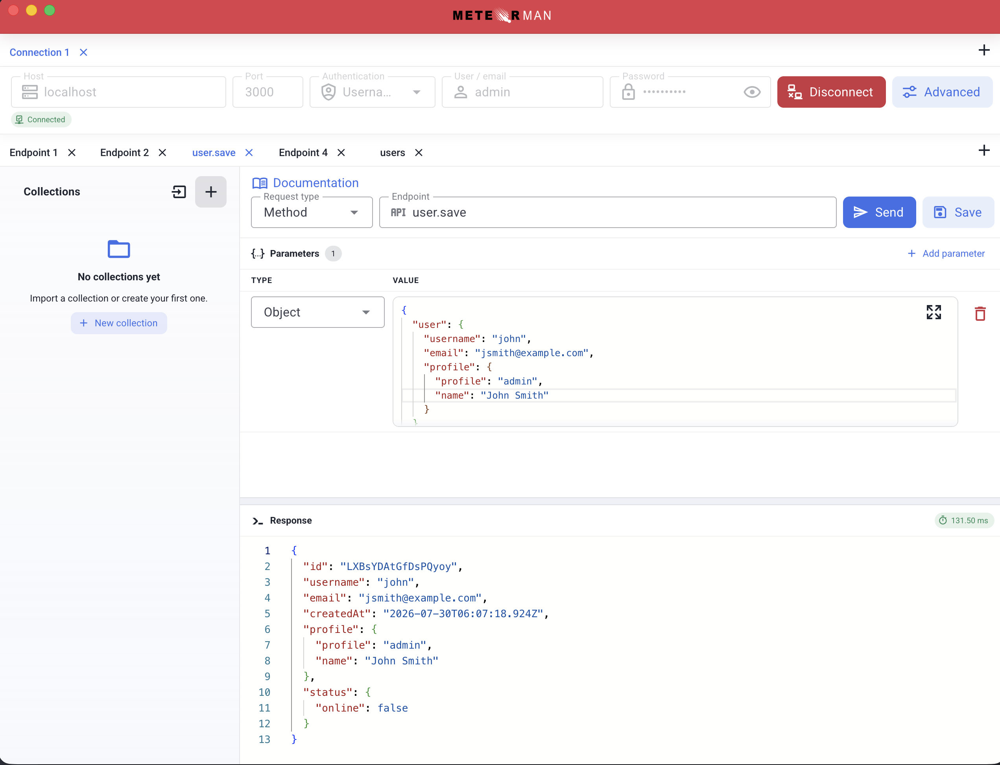

<div align="center">
<br>

<br>
<br>
</div>

<p align="center" color="#6a737d">
A DDP Client with GUI
</p>

<div align="center">

[](http://forthebadge.com) 
[](http://forthebadge.com) 
[](http://forthebadge.com)
[](http://forthebadge.com)

</div>

## Starting 🚀

Meteorman is The Postman of Meteor. It is a DDP Client with GUI

### Preview 🎥



### Supported Platforms 💻

- macOS 🍎 ✅
- Linux 🐧 ✅
- Windows ✅

### Downloads & Installation 💾

Download Meteorman 3.0.0 for your platform:

| Platform | Arch | Package | Link |
| --- | --- | --- | --- |
| macOS (Apple Silicon) | arm64 | ZIP | [Download](https://github.com/antwaremx/meteorman/releases/download/v3.0.0/Meteorman-darwin-arm64-3.0.0.zip) |
| Windows | x64 | Setup EXE | [Download](https://github.com/antwaremx/meteorman/releases/download/v3.0.0/Meteorman-3.0.0.Setup.exe) |
| Linux (Debian/Ubuntu) | amd64 | DEB | [Download](https://github.com/antwaremx/meteorman/releases/download/v3.0.0/meteorman_3.0.0_amd64.deb) |
| Linux (RPM) | x86_64 | RPM | [Download](https://github.com/antwaremx/meteorman/releases/download/v3.0.0/meteorman-3.0.0-1.x86_64.rpm) |

Extract the macOS ZIP and open Meteorman, run the Windows installer, or install
the Linux package with your distribution's package manager.


## For Developers 🚀

### System Requirements 📋

- A current Node.js LTS release
- npm

### Installation 🔧

[git](https://git-scm.com/) is required to run the following console commands:
```sh
$ git clone https://github.com/antwaremx/meteorman
```

### Build Setup 📦

```sh
# install dependencies
$ npm install

# start Electron Forge with Vite hot reload
$ npm start

# type-check the Electron and Vue application
$ npm run typecheck

# package the application for the current platform
$ npm run build

# create an installer/archive for the current platform
$ npm run make

# target a configured Electron Forge maker explicitly
$ npm run make:mac
$ npm run make:windows
$ npm run make:linux
```

Forge writes distributable output to `out/make`. Native tooling and maker
requirements still apply: use the matching operating system or a configured CI
runner for production artifacts. In particular, the Windows and Linux commands
are exposed for consistent workflows but are not guaranteed to cross-build
complete release artifacts from macOS.

### Application stack

- Electron and Electron Forge
- Vue 3 with TypeScript
- Vite
- Vuetify
- Pinia
- Monaco Editor

The renderer runs without Node.js integration. Native collection import/export is
exposed through a small context-isolated preload API.

---

<div align="center">
<br>

<br>
<br>
</div>
